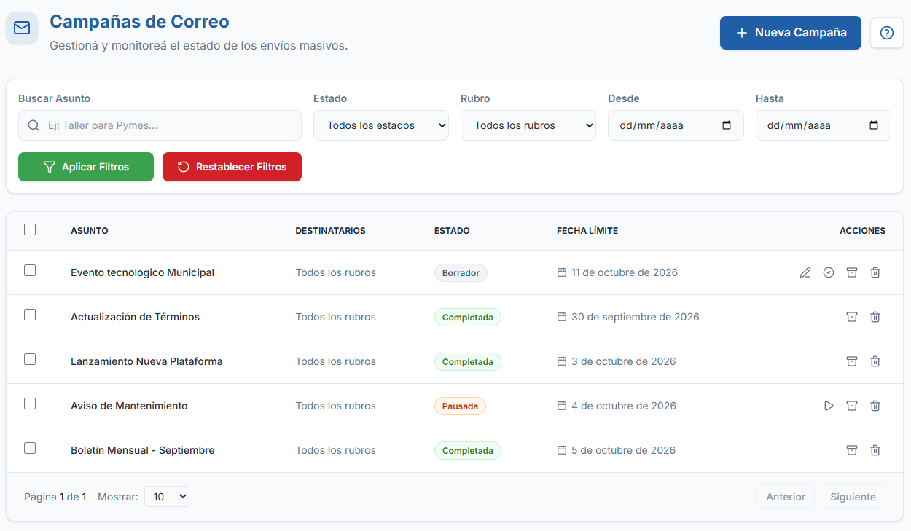
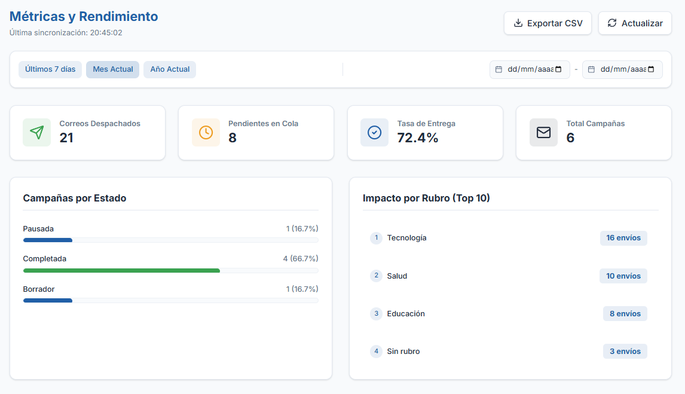
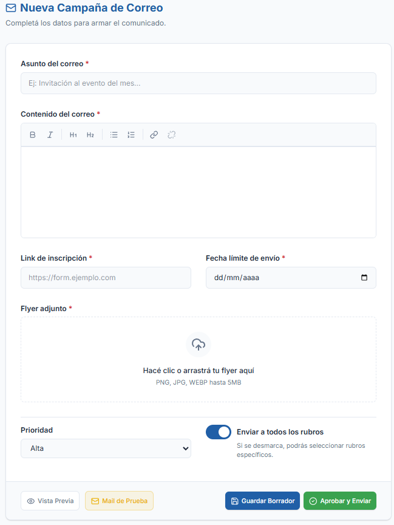
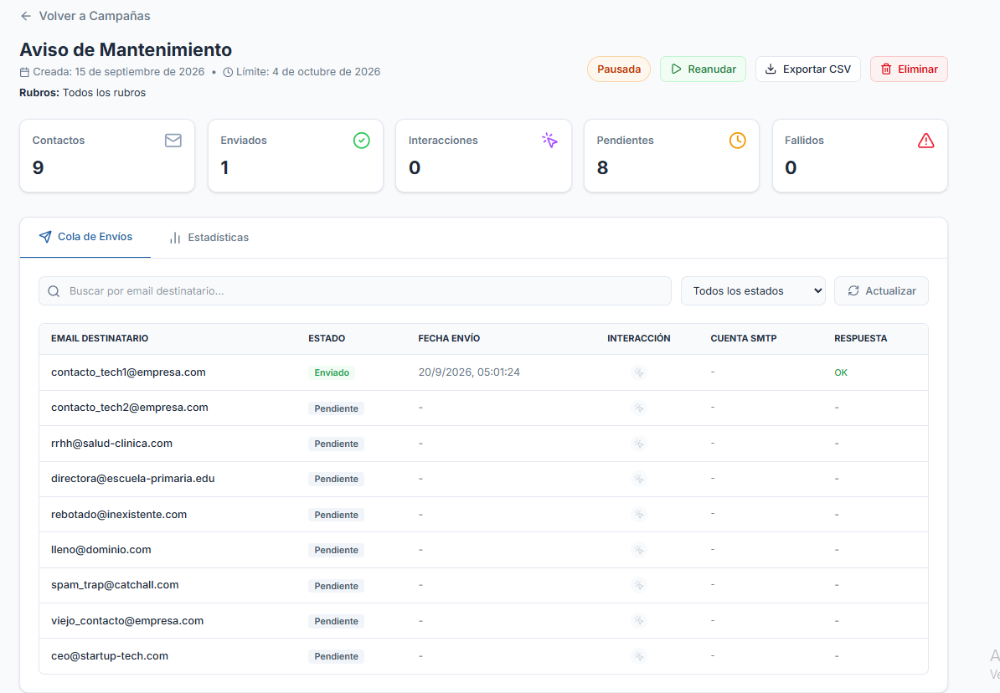
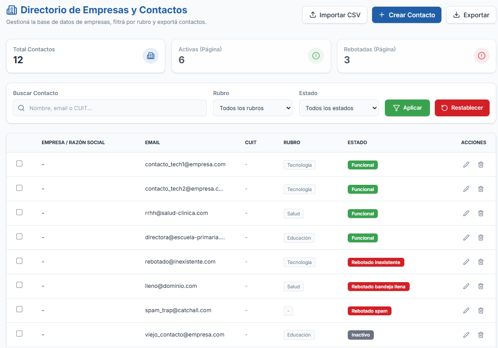
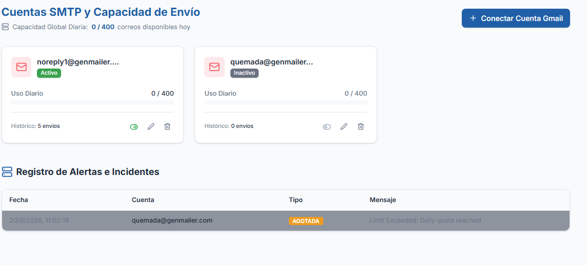
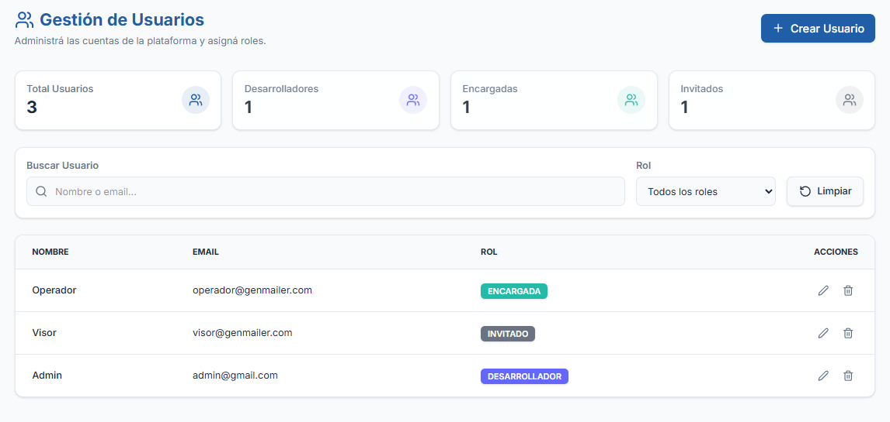

# 🚀 GenMailer — Plataforma Integral de Mailing & Gestión de Campañas



Una plataforma modular de grado productivo para el envío masivo y transaccional de correos electrónicos, gestión avanzada de audiencias y telemetría de entregabilidad en tiempo real. Diseñada para sortear límites estrictos de proveedores de correo (Google Workspace / Gmail), garantizar alta reputación de remitente y ofrecer una experiencia fluida tanto a operadores de comunicación como a administradores de infraestructura.

---

## 🎯 El Problema que Resuelve (Valor de Negocio)

El envío masivo de correos suele enfrentar obstáculos críticos cuando las organizaciones no pueden costear plataformas corporativas costosas por volumen o cuando sus envíos caen recurrentemente en carpetas de Spam:

1. **El Límite Estricto de Google / Gmail (Cuotas Diarias):**
   - *Problema:* Las cuentas estándar y de Google Workspace imponen techos rígidos (500 correos diarios por cuenta). Superar este límite resulta en el bloqueo inmediato de la cuenta por 24 horas.
   - *Solución:* **GenMailer** implementa un **Gestor Inteligente de Colas Round-Robin** con soporte para múltiples cuentas autenticadas vía **Gmail API (OAuth 2.0)**. La plataforma distribuye la carga equitativamente entre el pool de cuentas disponibles, permitiendo escalar el volumen diario a miles de destinatarios de forma balanceada y totalmente transparente para el usuario final.

2. **Filtros Anti-Spam y Bloqueos de Dominio:**
   - *Problema:* Disparar cientos de correos idénticos por segundo provoca que los algoritmos de spam de Gmail, Microsoft Outlook y Yahoo marquen el remitente como abusivo o envíen las comunicaciones a "Promociones" o "No deseado".
   - *Solución:* 
     - **Cadencia Humana:** Workers asíncronos dosifican los envíos con intervalos variables pseudo-aleatorios (delays calculados).
     - **Entropía HTML & Headers Dinámicos:** Generación dinámica de `Message-ID` únicos basados en criptografía RFC 2822, inserción de marcadores invisibles de entropía y optimización de contenido inline (CID) para imágenes.
     - **Horarios Operativos Inteligentes:** Los envíos se pausan fuera del horario laboral o fines de semana para evitar patrones de bot spam.

3. **Correos Rebotados y Pérdida de Reputación:**
   - *Problema:* Enviar correos a casillas inactivas, inexistentes o llenas (Hard/Soft Bounces) daña severamente el "Sender Score" del dominio.
   - *Solución:* 
     - **Integración con Webhooks Oficiales (Resend + Svix):** Verificación criptográfica de firmas para capturar en milisegundos eventos de rebote (`email.bounced`), quejas de spam (`email.complained`), aperturas (`email.opened`) y clics (`email.clicked`).
     - **Lista Negra y Limpieza Automática:** El sistema bloquea de inmediato destinatarios con rebotes duros para nunca volver a enviarles, manteniendo las bases de datos higienizadas.

4. **Operación No Técnica y Flujo de Trabajo Simple:**
   - *Problema:* Los equipos de operaciones o comunicación necesitan enviar comunicados enriquecidos sin lidiar con HTML ni configuraciones de red complejas.
   - *Solución:* Editor visual Tiptap enriquecido, vista previa interactiva, soporte para flyers con incrustación inline para máxima compatibilidad visual en clientes de correo móvil, y subida de hasta 6 archivos adjuntos validados.

---

## ⚡ Características Principales

- **Gestor Inteligente de Colas SMTP & OAuth 2.0:** Rotación automática (Round Robin) y balanceo de carga entre cuentas SMTP tradicionales y autenticación oficial mediante **Gmail API (OAuth 2.0)** sin depender de contraseñas de aplicación.
- **Webhooks de Resend con Verificación Criptográfica Svix:** Integración nativa securizada para procesar telemetría de eventos en tiempo real y persistencia inmediata en PostgreSQL.
- **Centro de Notificaciones en Tiempo Real (SSE):** Arquitectura reactiva basada en Server-Sent Events que informa inmediatamente al usuario sobre el progreso de los envíos, pausas, finalización o alertas de servidor sin recargar la página.
- **Cadencia Humana Anti-Spam & Dosificador Operativo:** Envíos modulados con delays inteligentes, cuotas diarias dinámicas por cuenta y control de franjas horarias operativas.
- **Procesamiento Asíncrono (Workers & Redis):** Tareas en segundo plano (Cron Jobs) que manejan el despacho progresivo de correos y la sincronización automática de bandejas para detectar rebotes.
- **Dashboard Estadístico y Exportación Ejecutiva:** Gráficos interactivos de altas y bajas, tasas de entrega y efectividad por rubro, con generación de reportes ejecutivos listos para exportar en PDF o imprimir.
- **Autenticación y Permisos (RBAC):** Acceso asegurado mediante **JWT (JSON Web Tokens)** con control de acceso basado en roles (`desarrollador`, `encargado`, `invitado`).
- **Gestor de Contactos, Rubros y Adjuntos Múltiples:** Importación/Exportación masiva de bases de datos mediante CSV o Excel, soporte de hasta 6 archivos adjuntos validados y filtrado automático de correos en lista negra.
- **Seguridad y Trazabilidad:** Las credenciales SMTP se cifran nativamente con **AES-256-GCM**. Todo el sistema cuenta con **Logs estructurados** (Winston con rotación diaria) y scripts de **Backups** automatizados.
- **Sistema Integrado de Soporte:** Módulo de ticketing donde los usuarios regulares pueden reportar incidencias o sugerencias directamente al equipo técnico.

---

## 🛠️ Stack Tecnológico

### Backend
- **Node.js & Express con TypeScript:** API RESTful modular, limpia y fuertemente tipada.
- **PostgreSQL & Redis:** Persistencia transaccional relacional (consultas optimizadas, agregaciones y claves foráneas) asistida por Redis para cacheo y control de estados efímeros.
- **Zod:** Validación estricta de esquemas tanto a nivel API HTTP como en eventos asíncronos.
- **Nodemailer & Google APIs (Gmail REST API):** Manejo de protocolos SMTP estándar y despacho nativo OAuth2.
- **Svix:** Verificación de firmas criptográficas para webhooks entrantes.
- **SSE (Server-Sent Events):** Stream reactivo unidireccional de notificaciones en vivo.
- **node-cron & Winston:** Workers para despacho en background con rotación diaria de logs de auditoría.
- **Criptografía nativa (Node.js crypto):** Cifrado AES-256-GCM para secretos almacenados en base de datos.

### Frontend
- **React.js (Vite) + TypeScript:** SPA rápida, tipada y reactiva.
- **TailwindCSS:** Sistema de diseño responsivo con estética moderna, micro-animaciones y paleta accesible.
- **Zustand:** Gestión de estado global ligera para autenticación y notificaciones.
- **Recharts:** Renderizado interactivo de métricas de entrega y efectividad.
- **Lucide Icons:** Iconografía moderna y consistente.

### Infraestructura
- **Docker & Docker Compose:** Entorno completamente contenerizado (Backend, Frontend, PostgreSQL, Redis) listo para arrancar en un solo paso.

---

## 🚀 Cómo Levantar el Proyecto (Entorno Local)

El proyecto está 100% dockerizado para que su ejecución sea inmediata en cualquier sistema operativo.

### Prerrequisitos
- **Docker** y **Docker Compose** instalados y activos.

### Pasos

1. **Clonar el repositorio:**
   ```bash
   git clone https://github.com/LeonardoMuranodev/mailing-platform-demo.git
   cd mailing-platform-demo
   ```

2. **Configurar variables de entorno:**
   Copia el archivo de ejemplo:
   ```bash
   cp .env.example .env
   ```
   *(Los valores por defecto permiten levantar el sistema de inmediato con base de datos local y Redis).*

3. **Levantar los contenedores:**
   ```bash
   docker compose up --build
   ```

4. **Acceder a la Plataforma:**
   - **Frontend:** [http://localhost:80](http://localhost:80)
   - **Backend API:** [http://localhost:3000](http://localhost:3000)
   - La base de datos ejecutará automáticamente las migraciones SQL y el script de **Seeding** con datos iniciales de prueba (campañas, contactos, usuarios).
   - Credenciales de prueba: `admin@genmailer.com` / `Admin1234!`

---

## 📸 Galería de Vistas

| Dashboard y Estadísticas | Creación de Campañas |
| :---: | :---: |
|  |  |

| Historial de Campaña | Directorio de Contactos |
| :---: | :---: |
|  |  |

| Gestión de Cuentas SMTP | Gestión de Usuarios (RBAC) |
| :---: | :---: |
|  |  |

---

## 👤 Autor

**Leonardo Murano**  
Full-Stack Developer  
- [LinkedIn](https://www.linkedin.com/in/leonardo-murano)
- [GitHub](https://github.com/LeonardoMuranodev)
